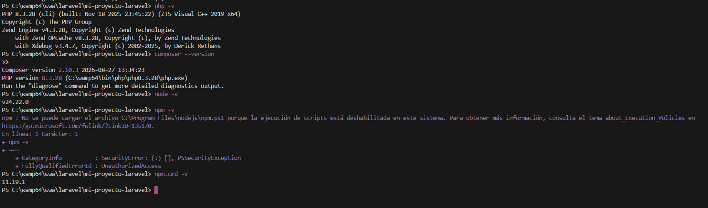
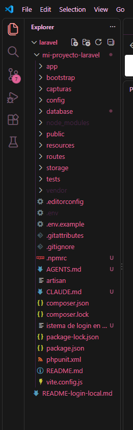
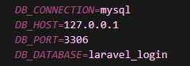
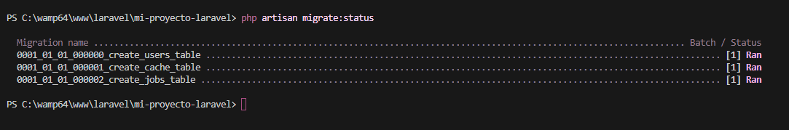
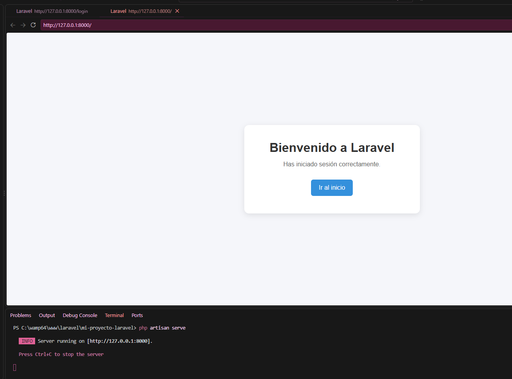
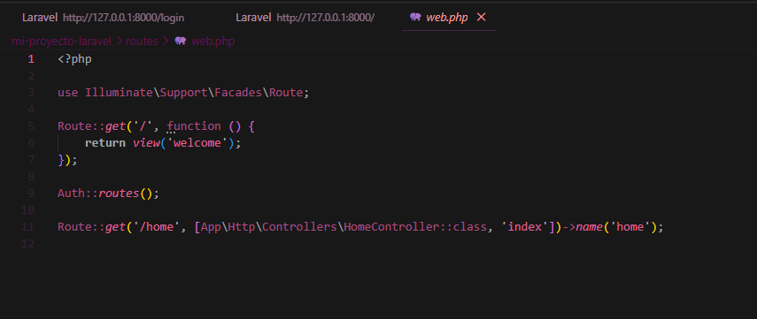
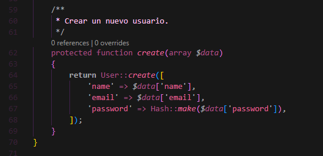
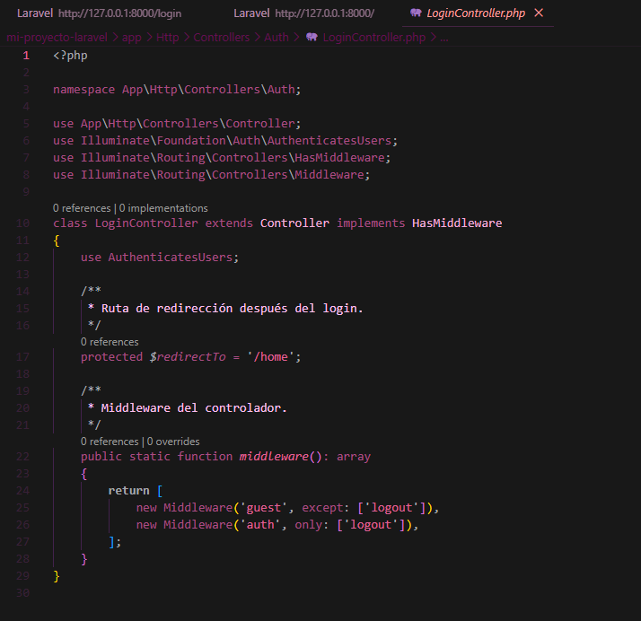

# Laboratorio 4 - Instalación, configuración y desarrollo web con Laravel

### Desarrollo Web

Estudiante: Ambar Greco  
Profesora: Irina Fong

---

## Introducción

En este laboratorio se trabajó con Laravel, un framework de PHP que facilita el desarrollo de aplicaciones web mediante una estructura organizada y herramientas que permiten gestionar rutas, controladores, vistas, bases de datos y sistemas de autenticación.

El objetivo principal fue conocer el proceso necesario para preparar un entorno de desarrollo con Laravel, desde la instalación de las herramientas requeridas hasta la creación y ejecución de una aplicación web funcional.

Durante el desarrollo se utilizaron Visual Studio Code, WAMP, PHP, Composer, MySQL, Node.js, NPM, Bootstrap y Laravel UI. Posteriormente, se implementó un sistema de autenticación que permite registrar usuarios, iniciar sesión, acceder a una página protegida y cerrar sesión.

También se realizaron pruebas para comprobar el funcionamiento de los formularios, verificar las validaciones de los datos ingresados y solucionar diferentes inconvenientes encontrados durante la configuración.

## Objetivos

- Conocer el proceso de instalación y configuración de Laravel.
- Preparar un entorno de desarrollo local utilizando WAMP y PHP.
- Utilizar Composer para instalar y administrar las dependencias del proyecto.
- Crear y ejecutar una aplicación Laravel desde Visual Studio Code.
- Configurar una conexión con una base de datos MySQL.
- Implementar un sistema de registro e inicio de sesión.
- Comprobar las validaciones y el funcionamiento del cierre de sesión.
- Documentar los procedimientos realizados mediante capturas de pantalla.

---

## 1. Herramientas utilizadas

Para realizar este laboratorio se utilizaron diferentes tecnologías y herramientas relacionadas con el desarrollo web.

- WAMP: Entorno de desarrollo local que proporciona Apache, PHP y MySQL.
- PHP: Lenguaje de programación utilizado para ejecutar la lógica del sistema.
- Composer: Administrador de dependencias utilizado para instalar Laravel y sus paquetes.
- Laravel: Framework utilizado para desarrollar la aplicación web.
- Visual Studio Code: Editor utilizado para crear, organizar y modificar los archivos del proyecto.
- MySQL: Sistema gestor de bases de datos utilizado para almacenar la información de los usuarios.
- Node.js y NPM: Herramientas utilizadas para instalar y compilar las dependencias frontend.
- Bootstrap: Framework utilizado para el diseño de los formularios y la interfaz.
- Laravel UI: Paquete utilizado para generar la estructura del sistema de autenticación.
- Git y GitHub: Herramientas utilizadas para administrar versiones y almacenar el código del proyecto.

## 2. Preparación del entorno de desarrollo

Antes de comenzar con Laravel fue necesario disponer de las herramientas que permiten ejecutar aplicaciones PHP en un entorno local.

### 2.1. Instalación de WAMP

WAMP permite ejecutar aplicaciones web desde una computadora con Windows utilizando un servidor local.

Para preparar el entorno se debe descargar WampServer desde su página oficial e instalarlo siguiendo las instrucciones correspondientes.

Página oficial: https://wampserver.aviatechno.net/

Una vez instalado, se utiliza la carpeta `www` para almacenar los proyectos web.

En este laboratorio se trabajó con la siguiente ubicación:

```text
C:\wamp64\www\laravel
```

Dentro de esta carpeta se creó el directorio que contiene el proyecto Laravel.

### 2.2. Instalación de Composer

Composer es una herramienta que permite instalar Laravel y administrar las bibliotecas necesarias para ejecutar aplicaciones PHP.

Página oficial: https://getcomposer.org/

Después de instalar Composer, se comprueba su funcionamiento utilizando:

```bash
composer --version
```

Este comando permite visualizar la versión instalada y verificar que Composer se encuentra disponible en el sistema.

### 2.3. Comprobación de PHP

Laravel necesita PHP para ejecutar sus aplicaciones.

Para comprobar que PHP está disponible se utiliza:

```bash
php -v
```

Este comando muestra información sobre la versión instalada.

En este laboratorio se utilizó PHP 8.3.28.

### 2.4. Instalación de Visual Studio Code

Visual Studio Code se utilizó para crear, visualizar y modificar los archivos correspondientes al proyecto Laravel.

Página oficial: https://code.visualstudio.com/

Este editor permite trabajar con PHP, HTML, CSS, JavaScript y otros archivos necesarios para el desarrollo de aplicaciones web.

### 2.5. Comprobación de las herramientas instaladas

Después de preparar el entorno de desarrollo, se verificaron las versiones de PHP, Composer, Node.js y NPM desde la terminal de Visual Studio Code.

Se utilizaron los siguientes comandos:

```powershell
php -v
composer --version
node -v
npm.cmd -v
```

Las versiones comprobadas fueron:

- PHP: 8.3.28
- Composer: 2.10.3
- Node.js: 24.22.0
- NPM: 11.19.1

Durante la comprobación se presentó un error al ejecutar `npm -v`, debido a las restricciones de seguridad de PowerShell.

Este inconveniente se solucionó ejecutando `npm.cmd -v`, lo que permitió comprobar la versión de NPM sin modificar las políticas de seguridad de Windows.

La siguiente captura muestra las versiones instaladas y la solución aplicada.



---

## 3. Creación del proyecto Laravel

Una vez preparado el entorno de desarrollo, se puede crear el proyecto utilizando Composer.

Primero se abre una terminal y se accede a la carpeta donde se almacenará la aplicación.

```powershell
cd C:\wamp64\www\laravel
```

Posteriormente, se utiliza el siguiente comando para crear un nuevo proyecto:

```bash
composer create-project laravel/laravel mi-proyecto-laravel
```

Este comando permite descargar Laravel y preparar la estructura inicial de la aplicación junto con sus dependencias.

Una vez finalizada la instalación, se accede a la carpeta del proyecto:

```bash
cd mi-proyecto-laravel
```

El proyecto contiene diferentes directorios que permiten organizar los controladores, modelos, configuraciones, vistas y rutas de la aplicación.

## 4. Apertura del proyecto en Visual Studio Code

Después de crear el proyecto, se abre Visual Studio Code y se selecciona la carpeta `mi-proyecto-laravel`.

Desde el explorador de archivos se puede visualizar la estructura de Laravel.

Entre las carpetas principales se encuentran:

- `app`: Contiene los modelos, controladores y otros componentes de la aplicación.
- `bootstrap`: Contiene archivos necesarios para iniciar Laravel.
- `config`: Almacena los archivos de configuración.
- `database`: Contiene las migraciones y otros archivos relacionados con la base de datos.
- `public`: Contiene el punto de entrada público de la aplicación.
- `resources`: Contiene las vistas, estilos y archivos JavaScript.
- `routes`: Contiene las rutas utilizadas por la aplicación.
- `storage`: Almacena archivos generados durante el funcionamiento.
- `tests`: Contiene archivos relacionados con las pruebas de la aplicación.

La siguiente captura muestra la estructura del proyecto dentro de Visual Studio Code.



## 5. Configuración del archivo .env

Laravel utiliza un archivo llamado `.env` para almacenar las variables de configuración del entorno.

Este archivo permite establecer datos como el nombre de la aplicación, la conexión con la base de datos y otras configuraciones.

Si el archivo no existe, se puede crear a partir de `.env.example` utilizando:

```powershell
Copy-Item .env.example .env
```

Posteriormente, se genera la clave de la aplicación mediante:

```bash
php artisan key:generate
```

Esta clave es utilizada por Laravel para diferentes mecanismos de seguridad y cifrado.

Por seguridad, el archivo `.env` no debe publicarse en GitHub, ya que puede contener información privada, contraseñas y claves de configuración.

---

## 6. Configuración de la base de datos

Para almacenar la información de los usuarios se utilizó MySQL, mediante el entorno de desarrollo WAMP.

La conexión se configuró en el archivo `.env` de Laravel, estableciendo los siguientes parámetros:

```env
DB_CONNECTION=mysql
DB_HOST=127.0.0.1
DB_PORT=3306
DB_DATABASE=laravel_login
```

Esta configuración permite que Laravel se conecte a la base de datos local llamada `laravel_login`.

Los valores correspondientes al usuario y la contraseña de MySQL también deben configurarse según el entorno utilizado.

### 6.1. Configuración de MySQL

Para utilizar MySQL es necesario disponer de una base de datos creada previamente.

La base de datos utilizada en este proyecto recibe el nombre:

```text
laravel_login
```

Laravel utiliza la información del archivo `.env` para establecer la conexión con el servidor MySQL.

La siguiente captura muestra los parámetros principales de conexión configurados en el proyecto.



### 6.2. Ejecución de las migraciones

Después de configurar la conexión con MySQL, se ejecutan las migraciones de Laravel.

Para ello se utiliza:

```bash
php artisan migrate
```

Este comando permite crear las tablas necesarias para el funcionamiento de la aplicación.

Entre las migraciones principales se encuentran:

- `create_users_table`: Crea la tabla utilizada para almacenar los usuarios.
- `create_cache_table`: Crea la tabla utilizada para almacenar información de caché.
- `create_jobs_table`: Crea la tabla utilizada para gestionar trabajos en segundo plano.

Para comprobar el estado de las migraciones se ejecutó:

```bash
php artisan migrate:status
```

El resultado mostró que las tres migraciones se encontraban ejecutadas correctamente, con el estado `Ran`.



Esto permitió verificar que las tablas necesarias para la aplicación habían sido creadas.

---

## 7. Ejecución inicial de Laravel

Para comprobar que el proyecto funciona correctamente, se abre una terminal dentro de la carpeta principal.

Se ejecuta el siguiente comando:

```bash
php artisan serve
```

Laravel inicia un servidor local y muestra una dirección que normalmente corresponde a:

```text
http://127.0.0.1:8000
```

Al abrir esta dirección en el navegador, se puede visualizar la aplicación web.

Durante las pruebas se comprobó que el servidor funcionaba correctamente y que la página principal respondía a las solicitudes del navegador.

La siguiente captura muestra el servidor en funcionamiento y la aplicación abierta desde Visual Studio Code.



---

## 8. Instalación del sistema de autenticación

Después de comprobar el funcionamiento inicial de Laravel, se procede a configurar el sistema de autenticación.

Para ello se utiliza Laravel UI, un paquete que permite generar formularios de autenticación utilizando Bootstrap.

Primero se instala el paquete mediante Composer:

```bash
composer require laravel/ui
```

Posteriormente, se ejecuta:

```bash
php artisan ui bootstrap --auth
```

Este comando genera diferentes archivos relacionados con el sistema de autenticación.

Entre ellos se encuentran los formularios de inicio de sesión, registro de usuarios, recuperación de contraseñas y los controladores necesarios.

## 9. Instalación y compilación de recursos frontend

Una vez configurado Laravel UI, es necesario instalar las dependencias de JavaScript y los estilos utilizados por la aplicación.

Para ello se ejecuta:

```bash
npm.cmd install
```

Posteriormente, se compilan los recursos utilizando:

```bash
npm.cmd run build
```

Laravel utiliza Vite para procesar y compilar los archivos de estilos y JavaScript.

Esto permite que Bootstrap y los demás recursos visuales se carguen correctamente en el navegador.

Se utilizó `npm.cmd` debido a las restricciones de PowerShell detectadas anteriormente.

---

## 10. Configuración de las rutas

Las rutas permiten determinar qué contenido se mostrará cuando un usuario acceda a una dirección específica.

En este proyecto se utilizó el archivo:

`routes/web.php`

El archivo contiene la siguiente configuración:

```php
<?php

use Illuminate\Support\Facades\Route;

Route::get('/', function () {
    return view('welcome');
});

Auth::routes();

Route::get('/home', [App\Http\Controllers\HomeController::class, 'index'])->name('home');
```

La primera ruta define la página de bienvenida de la aplicación.

La instrucción `Auth::routes()` registra las rutas relacionadas con el sistema de autenticación.

La ruta `/home` dirige al usuario hacia la página principal después de iniciar sesión.

La siguiente captura muestra el contenido del archivo `web.php` dentro de Visual Studio Code.



---

## 11. Implementación del registro de usuarios

El formulario de registro permite crear nuevas cuentas dentro de la aplicación.

Se encuentra en el archivo:

`resources/views/auth/register.blade.php`

El formulario solicita la siguiente información:

- Nombre del usuario.
- Correo electrónico.
- Contraseña.
- Confirmación de contraseña.

Cuando el usuario completa el formulario, Laravel procesa la información y aplica las validaciones correspondientes.

Si los datos son válidos, se puede crear una cuenta y almacenar la información en MySQL.

### 11.1. Controlador del registro

El archivo `RegisterController.php` contiene la lógica utilizada para gestionar el registro.

Dentro de este controlador se encuentra el método `create()`, encargado de almacenar la información de un nuevo usuario.

El método utiliza `User::create()` para registrar los datos y `Hash::make()` para generar un hash de la contraseña antes de almacenarla.

Esto permite evitar que las contraseñas se almacenen como texto plano.

La siguiente captura muestra el método utilizado para crear nuevos usuarios.



### 11.2. Resultado del formulario de registro

La siguiente imagen muestra el formulario que permite crear nuevas cuentas.


---

## 12. Implementación del inicio de sesión

El formulario de inicio de sesión permite que los usuarios registrados accedan a la aplicación.

Se encuentra en el archivo:

`resources/views/auth/login.blade.php`

Para iniciar sesión, el usuario debe introducir su correo electrónico y contraseña.

Laravel comprueba las credenciales y, cuando son correctas, permite acceder a las páginas protegidas.

El formulario también incluye la opción de recordar la sesión y un enlace para recuperar la contraseña.

### 12.1. Controlador del inicio de sesión

El archivo `LoginController.php` contiene la configuración relacionada con la autenticación.

En este controlador se utiliza `AuthenticatesUsers`, que proporciona la funcionalidad necesaria para el inicio de sesión.

También se establece la ruta de redirección:

```php
protected $redirectTo = '/home';
```

Esta configuración permite enviar al usuario al Dashboard cuando inicia sesión correctamente.

Además, el método `middleware()` configura las restricciones de acceso correspondientes a usuarios autenticados y visitantes.

La siguiente captura muestra el controlador utilizado en el proyecto.



### 12.2. Resultado del inicio de sesión

La siguiente imagen muestra el formulario utilizado para ingresar al sistema.


---

## 13. Acceso al Dashboard

Cuando un usuario inicia sesión correctamente, es dirigido hacia la página principal de la aplicación.

Esta vista se encuentra en:

`resources/views/home.blade.php`

En el Dashboard aparece un mensaje indicando que el usuario ha iniciado sesión correctamente.

Esto permite comprobar que el proceso de autenticación funciona.


## 14. Implementación del cierre de sesión

El sistema también permite que los usuarios finalicen su sesión.

Para ello se utiliza un menú desplegable ubicado en la parte superior derecha de la aplicación.

Al seleccionar la opción de cerrar sesión, Laravel finaliza la autenticación del usuario.

Esta funcionalidad permite evitar que una sesión permanezca abierta cuando el usuario ya no necesita utilizar la aplicación.


---

## 15. Validaciones del sistema

Durante el laboratorio se realizaron diferentes pruebas para comprobar el funcionamiento de las validaciones.

### 15.1. Contraseñas que no coinciden

Se introdujeron contraseñas diferentes en los campos de contraseña y confirmación.

Laravel detectó la diferencia y mostró un mensaje indicando que la confirmación de contraseña no coincidía.

Esta validación evita que se complete el registro cuando las contraseñas son diferentes.


### 15.2. Credenciales incorrectas

También se realizó una prueba intentando iniciar sesión con un correo electrónico y una contraseña que no correspondían a un usuario registrado.

Laravel rechazó el intento y mostró un mensaje indicando que las credenciales no coincidían con los registros almacenados.


Estas pruebas permitieron verificar que el sistema responde correctamente ante diferentes errores de autenticación.

---

## 16. Problemas encontrados y soluciones

Durante el desarrollo y la preparación del entorno se presentaron algunos inconvenientes que fue necesario solucionar.

### 16.1. Restricción de ejecución de NPM

Al ejecutar `npm -v` desde PowerShell, Windows mostró un mensaje indicando que la ejecución de scripts estaba deshabilitada.

Para solucionar este inconveniente se utilizó:

```powershell
npm.cmd -v
```

Este comando permitió utilizar NPM sin modificar la configuración de seguridad del sistema.

### 16.2. Configuración de los recursos visuales

Para cargar correctamente los estilos y archivos JavaScript del proyecto fue necesario revisar la configuración de Vite y las referencias a los recursos utilizados por Laravel.

Posteriormente, se compilaron los archivos frontend para que los estilos se visualizaran correctamente en el navegador.

### 16.3. Conexión con GitHub

Durante la preparación del repositorio del sistema de login se presentó un problema con la conexión HTTPS de Git.

Windows bloqueó una biblioteca utilizada por Git debido a una política de seguridad del sistema.

Para solucionar el inconveniente se configuró una conexión mediante SSH, utilizando una clave pública asociada a la cuenta de GitHub.

Después de establecer la conexión, fue posible subir los archivos del proyecto sin modificar las políticas de seguridad de Windows.

---

## 17. Archivos principales del proyecto

Durante el desarrollo se trabajó con diferentes archivos que cumplen funciones específicas.

- `app/Http/Controllers/Auth/LoginController.php`: Controlador relacionado con el inicio de sesión.
- `app/Http/Controllers/Auth/RegisterController.php`: Controlador encargado del registro de usuarios.
- `app/Http/Controllers/Auth/ForgotPasswordController.php`: Controlador relacionado con la recuperación de contraseñas.
- `app/Http/Controllers/HomeController.php`: Controlador de la página principal del usuario.
- `app/Models/User.php`: Modelo que representa a los usuarios.
- `resources/views/auth/login.blade.php`: Vista del formulario de inicio de sesión.
- `resources/views/auth/register.blade.php`: Vista del formulario de registro.
- `resources/views/home.blade.php`: Vista del Dashboard.
- `routes/web.php`: Archivo que contiene las rutas web.
- `database/migrations/`: Directorio que contiene las migraciones de la base de datos.
- `vite.config.js`: Archivo de configuración de Vite.
- `composer.json`: Archivo que contiene las dependencias PHP del proyecto.

---

## 18. Resultados obtenidos

Al finalizar el laboratorio se logró preparar un entorno local de desarrollo con Laravel y ejecutar una aplicación web funcional.

Se configuraron los componentes necesarios para trabajar con PHP, Composer, MySQL, Bootstrap, Node.js, NPM y Laravel UI.

También se implementó un sistema de autenticación que permite registrar usuarios, iniciar sesión, acceder al Dashboard y cerrar sesión.

Las pruebas realizadas demostraron que Laravel puede detectar errores en los formularios y controlar el acceso mediante las credenciales de los usuarios.

Además, se logró documentar el procedimiento mediante capturas de pantalla, mostrando tanto la configuración del entorno como el funcionamiento de los diferentes componentes del proyecto.

## 19. Repositorio del sistema de login

El código fuente del sistema de autenticación, junto con sus capturas y documentación específica, se encuentra disponible en el siguiente repositorio:

[Laboratorio 2 - Sistema de Login en Laravel](https://github.com/lilambaru/laboratorio-2-login-laravel)

Este repositorio complementa la documentación presentada en el Laboratorio 4 y permite consultar los archivos utilizados durante el desarrollo.

## 20. Conclusión

El desarrollo de este laboratorio permitió comprender el procedimiento necesario para instalar, configurar y ejecutar un proyecto web utilizando Laravel.

Durante la práctica se reforzaron los conocimientos relacionados con PHP, Composer, MySQL, la estructura de Laravel, las rutas, los controladores, las vistas y la conexión con una base de datos.

La implementación del sistema de autenticación permitió aplicar estos conocimientos mediante el registro de usuarios, el inicio de sesión, el cierre de sesión y las validaciones de los formularios.

Asimismo, la resolución de los inconvenientes encontrados durante la configuración permitió comprender la importancia de revisar las dependencias, los archivos de configuración y las herramientas utilizadas en el entorno de desarrollo.

Finalmente, el uso de Visual Studio Code, Git y GitHub facilitó la organización del proyecto y la documentación del trabajo realizado, fortaleciendo los conocimientos prácticos en el desarrollo de aplicaciones web.
